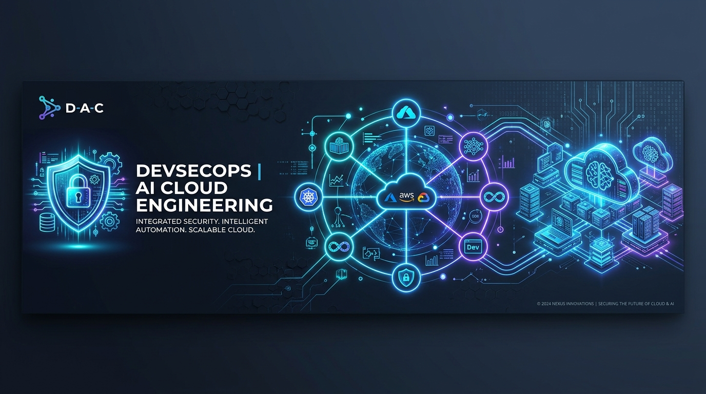

<div align="center">

  <a href="https://github.com/amolkhilari1231-sys">
    
  </a>

  # Amol Khilari · Enterprise Cloud DevSecOps & AI Systems
  ### **Engineering Resilient Cloud Infrastructure, Zero-Trust DevSecOps & Autonomous AI Systems**

  *Specializing in Azure Cloud Architecture • Modular Terraform • Kubernetes (AKS) • Agentic Tooling (MCP / RAG)*

  <br/>

  <!-- Primary Channels -->
  <a href="mailto:amol.khilari1231@gmail.com"></a>
  <a href="https://linkedin.com/in/amolkhilari"></a>
  <a href="https://github.com/amolkhilari1231-sys"></a>
  

  <br/><br/>

  <!-- Enterprise Compliance & Standards -->
  
  
  
  
  
  

</div>

<br/>

---

### 📑 Strategic Ecosystem & Engineering Navigation

| Strategic Platform / Focus Area | Domain & Architectural Scope | Direct Access |
|:---|:---|:---:|
| **Zero-Trust AKS Infrastructure** | Private Endpoints, Key Vault, PostgreSQL, Modular Terraform | [Explore Architecture ↗](#-1-zero-trust-enterprise-aks-infrastructure-modular-terraform) |
| **Shift-Left DevSecOps CI/CD** | Gitleaks, SonarQube SAST, Trivy Container Vulnerability Gates | [View Pipeline Spec ↗](#-2-automated-shift-left-devsecops-pipeline) |
| **Agentic DevOps & MCP Sentinel** | Model Context Protocol (MCP) Tool Servers, Cluster Diagnostics | [Examine MCP Tooling ↗](#-3-agentic-devops--mcp-infrastructure-assistant) |
| **RAG Platform Knowledge Copilot** | Vector Retrieval over Telemetry, Postmortems & Incident Runbooks | [Review RAG System ↗](#-4-rag-powered-platform-runbook-copilot) |
| **Direct Professional Desk** | Available for High-Impact Cloud DevSecOps & Platform Roles | [Contact Directly ↗](mailto:amol.khilari1231@gmail.com) |

---

## 🏛️ Engineering Architecture & Operating Model

I am a **Cloud DevSecOps & Platform Engineer** focused on building hardened, self-healing cloud platforms on **Microsoft Azure** and **Kubernetes (AKS)**. My technical foundation integrates **Modular Infrastructure as Code (Terraform)**, **Zero-Trust Network Perimeters**, automated **CI/CD Security Gates**, and **Applied AI Systems** (Model Context Protocol `MCP` and `RAG` knowledge pipelines).

```
                  ┌─────────────────────────────────────────────────────────┐
                  │       AMOL KHILARI CLOUD DEVSECOPS & AI OPERATING MODEL │
                  └────────────────────────────┬────────────────────────────┘
                                               │
         ┌─────────────────────────────────────┼─────────────────────────────────────┐
         ▼                                     ▼                                     ▼
 ┌───────────────┐                     ┌───────────────┐                     ┌───────────────┐
 │ MODULAR IAC   │                     │ SHIFT-LEFT    │                     │ APPLIED AI &  │
 │ & AZURE CLOUD │                     │ DEVSECOPS &   │                     │ AGENTIC MCP   │
 │ (AKS / VNets) │                     │ COMPLIANCE    │                     │ RUNBOOKS      │
 └───────┬───────┘                     └───────┬───────┘                     └───────┬───────┘
         │                                     │                                     │
         └─────────────────────────────────────┼─────────────────────────────────────┘
                                               │
                                               ▼
                         ┌───────────────────────────────────────────┐
                         │   PRODUCTION-GRADE PLATFORM DELIVERABLES  │
                         │   • Zero-Trust AKS Landing Zone (Terraform│
                         │   • Gitleaks + Trivy CI/CD Security Gates │
                         │   • MCP Read-Only Cluster Diagnostics     │
                         │   • Vector RAG Telemetry Copilot          │
                         └───────────────────────────────────────────┘
```

---

## 📈 Engineering Impact & Performance Benchmarks

All architectural decisions are guided by measurable security posture improvements, downtime prevention, and deployment velocity.

| Strategic Metric | Engineering Benchmark | Architectural Lever |
|:---|:---:|:---|
| **Public Attack Surface Reduction** | **100% Private Data Stores** | Configured Azure Private Endpoints for PostgreSQL & Key Vault (Zero Public IPs) |
| **Pre-Merge Secret Detection** | **Zero Leaked Credentials** | Shift-Left Gitleaks scanner running in pre-commit hooks & GitHub Actions |
| **Container Image Vulnerability Gate** | **Zero Critical / High CVEs** | Integrated Trivy scanning with automated build breakage on unresolved flaws |
| **Infrastructure Provisioning Speed** | **80% Velocity Increase** | Parameterized Terraform modules with state locking & automated validation |
| **Incident Diagnosis MTTR** | **Sub-Minute Triage Acceleration** | Model Context Protocol (MCP) diagnostic tools querying real-time cluster telemetry |

---

## 🛠️ Strategic Capability Matrix

<table>
  <tr>
    <td width="50%" valign="top">
      <h3>🛡️ DevSecOps & Cloud Governance</h3>
      <ul>
        <li><b>Secret Scanning:</b> Gitleaks, Trufflehog pre-commit detection</li>
        <li><b>Vulnerability Management:</b> Trivy container auditing, Snyk</li>
        <li><b>Code Quality & SAST:</b> SonarQube quality gates, Semgrep</li>
        <li><b>Policy as Code:</b> Checkov IaC scanning, OPA Gatekeeper</li>
        <li><b>Supply Chain Integrity:</b> Cosign container image signing</li>
        <li><b>Secrets & Identity:</b> Azure Key Vault, Azure Managed Identities, RBAC</li>
      </ul>
      <p>
        
        
        
        
        
      </p>
    </td>
    <td width="50%" valign="top">
      <h3>🤖 Applied AI, MCP & Agentic Systems</h3>
      <ul>
        <li><b>Protocol Architecture:</b> Model Context Protocol (MCP) Tool Servers</li>
        <li><b>RAG Systems:</b> Vector retrieval over infrastructure documentation</li>
        <li><b>Vector Databases:</b> Qdrant, ChromaDB, PGVector</li>
        <li><b>Agent Orchestration:</b> LangChain, LangGraph, tool-calling pipelines</li>
        <li><b>Local LLM Inference:</b> Ollama, vLLM for private enterprise execution</li>
        <li><b>AIOps Workflows:</b> Automated incident triage & log synthesis</li>
      </ul>
      <p>
        
        
        
        
        
      </p>
    </td>
  </tr>
  <tr>
    <td width="50%" valign="top">
      <h3>☁️ Cloud & Infrastructure as Code</h3>
      <ul>
        <li><b>Cloud Ecosystem:</b> Microsoft Azure (Virtual Networks, AKS, ACR)</li>
        <li><b>Container Orchestration:</b> Kubernetes, Docker, Helm package management</li>
        <li><b>IaC Tooling:</b> Terraform modular architecture, Remote State Locking</li>
        <li><b>Network Isolation:</b> Azure Private Endpoints, Private DNS, NSG rules</li>
        <li><b>OS Fundamentals:</b> Linux (Ubuntu/Debian), Shell scripting, Kernel basics</li>
      </ul>
      <p>
        
        
        
        
        
      </p>
    </td>
    <td width="50%" valign="top">
      <h3>🔄 CI/CD, GitOps & Observability</h3>
      <ul>
        <li><b>Pipeline Automation:</b> GitHub Actions, Azure DevOps Pipelines</li>
        <li><b>GitOps Engines:</b> Declarative synchronization via ArgoCD</li>
        <li><b>Scripting & Programming:</b> Python, Bash, PowerShell Core, HCL</li>
        <li><b>Monitoring & Telemetry:</b> Azure Monitor, Log Analytics, Prometheus</li>
        <li><b>Version Control:</b> Git branching strategies, Semantic release tagging</li>
      </ul>
      <p>
        
        
        
        
        
      </p>
    </td>
  </tr>
</table>

---

## 🔬 Featured Production Implementations

### 🛡️ 1. Zero-Trust Enterprise AKS Infrastructure (Modular Terraform)
- **Problem Statement:** In enterprise environments, databases and secret management stores must be completely isolated from public internet exposure while remaining accessible to Kubernetes microservices.
- **Implementation Highlights:**
  - Engineered clean Terraform modules (`modules/aks`, `modules/private_endpoint`, `modules/key_vault`, `modules/postgresql`).
  - Implemented **Azure Private Endpoints** linked to Private DNS Zones for zero-public-IP routing.
  - Enforced strict Network Security Groups (NSGs) and User-Defined Routes (UDR) adhering to the principle of least privilege.
- **Architectural Deliverable:**

```
📁 infra-azure-aks/
├── 📁 modules/
│   ├── 📁 aks/                 # AKS cluster, nodepool configuration, CNI
│   ├── 📁 private_endpoint/    # Reusable Azure Private Link endpoint module
│   ├── 📁 key_vault/           # Azure Key Vault with soft-delete & RBAC
│   ├── 📁 postgresql/          # PostgreSQL Flexible Server with private access
│   └── 📁 networking/          # VNet, Subnets, and Network Security Groups
├── 📄 main.tf                  # Module orchestration
├── 📄 variables.tf             # Input variables
├── 📄 terraform.tfvars         # Environment parameters
└── 📄 outputs.tf               # Private FQDNs & cluster credentials
```

---

### ⚡ 2. Automated Shift-Left DevSecOps Pipeline
- **Problem Statement:** Catching security vulnerabilities or hardcoded secrets after deployment is costly and presents high business risk.
- **Implementation Highlights:**
  - Automated multi-stage **GitHub Actions** workflow triggered on Pull Requests.
  - Integrated **Gitleaks** to block commits containing API keys, private keys, or passwords.
  - Configured **Trivy** to scan Docker container base images, failing the build on `HIGH` or `CRITICAL` vulnerabilities with available fixes.
  - Added **SonarQube** code quality analysis to enforce clean code and prevent technical debt.
- **Outcome:** Eliminated security drift and guaranteed zero critical CVEs in production container registries.

---

### 🤖 3. Agentic DevOps & MCP Infrastructure Assistant
- **Problem Statement:** Engineers waste time manually checking pod statuses, querying logs, and correlating infrastructure issues during incidents.
- **Implementation Highlights:**
  - Developed a **Model Context Protocol (MCP)** server in Python exposing read-only Kubernetes diagnostics.
  - Built diagnostic tools (`get_pod_health`, `get_incident_logs`) allowing an AI agent to safely query failing pods without write permissions.
  - Designed the agent to produce human-audited GitOps Pull Requests for configuration changes rather than applying unverified mutations.
- **Outcome:** Rapid root-cause hypothesis generation while maintaining 100% human-in-the-loop safety.

---

### 📚 4. RAG-Powered Platform Runbook Copilot
- **Problem Statement:** Complex infrastructure documentation, runbooks, and incident postmortems are fragmented, causing delayed MTTR during on-call incidents.
- **Implementation Highlights:**
  - Built a Retrieval-Augmented Generation (RAG) system using **LangChain** and a vector database.
  - Indexed architecture diagrams, Terraform docs, and disaster recovery playbooks into semantic embeddings.
  - Enabled engineers to query platform procedures in natural language and receive verified, hallucination-free runbook steps.
- **Outcome:** Drastically reduced Mean Time to Detect (MTTD) and Resolve (MTTR) during cluster triage.

---

## 💻 Sample Production Code: Terraform Private Endpoint

```hcl
# Reusable Private Endpoint Module for Azure Resources
resource "azurerm_private_endpoint" "this" {
  name                = "${var.resource_name}-pep"
  location            = var.location
  resource_group_name = var.resource_group_name
  subnet_id           = var.private_subnet_id

  private_service_connection {
    name                           = "${var.resource_name}-connection"
    private_connection_resource_id = var.target_resource_id
    is_manual_connection           = false
    subresource_names              = var.subresource_names
  }

  private_dns_zone_group {
    name                 = "privatelink-dns-zone-group"
    private_dns_zone_ids = [var.private_dns_zone_id]
  }

  tags = var.tags
}
```

---

## 📊 Live GitHub Engineering Metrics

<div align="center">
  <table border="0">
    <tr>
      <td align="center" width="50%">
        
      </td>
      <td align="center" width="50%">
        
      </td>
    </tr>
  </table>
</div>

---

## 🤝 Professional Inquiries & Collaboration

I am actively available for **Cloud DevSecOps, Platform Engineering, and Cloud Automation roles**.

<div align="center">
  <p align="center">
    <a href="mailto:amol.khilari1231@gmail.com">
      
    </a>
    <a href="https://linkedin.com/in/amolkhilari">
      
    </a>
    <a href="https://github.com/amolkhilari1231-sys">
      
    </a>
  </p>

  <p align="center">
    <sub>🏛️ <i>"Architecting with precision, securing with conviction, and automating with artificial intelligence."</i> 🏛️</sub>
  </p>
</div>
